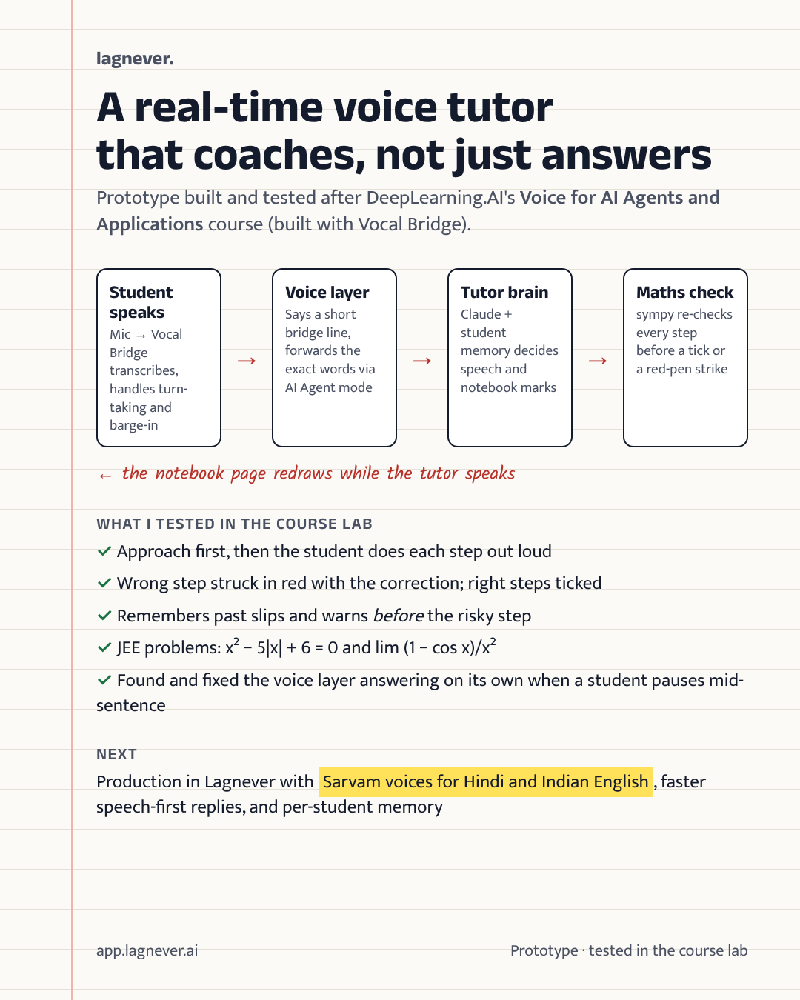
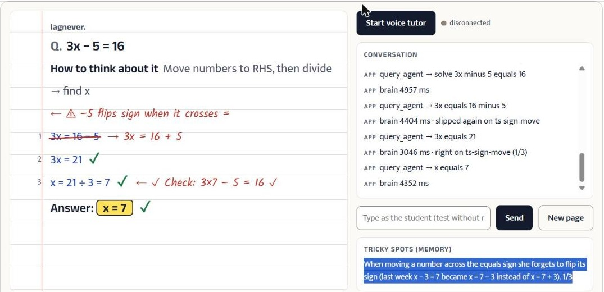
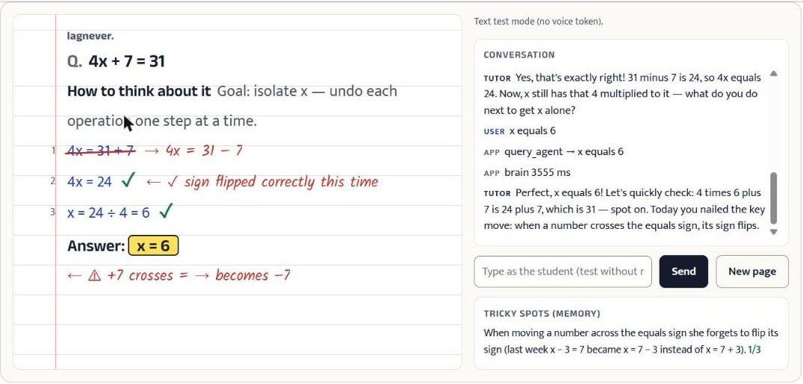

# Lagnever voice tutor

A real-time voice maths tutor you can run locally: for developers building voice AI agents,
AI tutors and EdTech products, including JEE and CBSE maths.


**Why it's different**

- **Coaches instead of answering.** Approach first, then the student says each step; right steps are
  ticked, wrong ones struck in red pen with the correction.
- **Maths verified by sympy, not the model.** If the checker and the model disagree, sympy wins.
- **The voice layer never does maths itself.** It listens, bridges the wait, and reads the tutor's reply
  word for word.

**Quick start in 3 commands** (after `cp .env.example .env` and adding your keys; full steps below)

```bash
pip install -r requirements.txt
python setup_agent.py
python app.py   # open http://localhost:8766
```

A real-time voice maths tutor that **coaches instead of just answering**. The student talks through a
problem out loud; the tutor writes the approach first, ticks right steps, strikes wrong ones in red pen
with the correction, and remembers each student's past slips so it can warn them before a risky step.

Prototype for [Lagnever](https://app.lagnever.ai), an AI tutor for Indian school students (CBSE, JEE),
built after DeepLearning.AI's *Voice for AI Agents and Applications* course.



**Demo video (65 s, both voices):** [docs/demo/voice_tutor_live.mp4](docs/demo/voice_tutor_live.mp4)

| Voice session | Text test mode |
| --- | --- |
|  |  |

## How it works

```
student mic ──► Vocal Bridge (speech-to-text, turn-taking, realtime voice)
                   │  AI Agent mode: forwards the student's exact words
                   ▼
              POST /query  (tutor.py, FastAPI)
                   │
                   ├─► tutor brain (Anthropic API, streamed tool call)
                   │      step_check ─► speech ─► board ops ─► memory
                   │
                   ├─► sympy checker (checker.py) re-checks the step
                   │      disagrees? draft dropped, turn redone
                   │
                   └─► speech returned as soon as it is ready
                          page ops finish in the background;
                          the page polls /state and redraws
```

- **Speech first.** The tutor brain streams one tool call per turn; the spoken reply is released before
  the notebook marks are written, which cut the time to speech from 4.8 s to 3.6 s on average.
- **Maths is checked by code, not by the model.** Every step verdict carries a machine-checkable spec that
  sympy re-checks in milliseconds. If they disagree, sympy wins: a right step is never struck and a wrong
  one is never ticked.
- **The voice layer never does maths.** It only listens, says a short bridge line while it waits, and reads
  the tutor's reply word for word ([vocal_bridge/prompt.md](vocal_bridge/prompt.md)).
- **Tricky spots.** Each student's recurring slips are remembered; the tutor adds a recall note before the
  risky step, and a tricky spot clears after three right answers in a row.

## Quick start

Requires Python 3.10+, an [Anthropic API key](https://console.anthropic.com) and a
[Vocal Bridge](https://vocalbridgeai.com) API key.

```bash
git clone https://github.com/BhimPrasadAdhikari/lagnever-voice-tutor.git
cd lagnever-voice-tutor
python -m venv .venv && source .venv/bin/activate      # Windows: .venv\Scripts\activate
pip install -r requirements.txt

cp .env.example .env          # then put your two API keys in .env
python setup_agent.py         # once: creates the voice agent and saves its id to .env
python app.py                 # open http://localhost:8766 and click "Start voice tutor"
```

- Already have a Vocal Bridge agent (for example from the course)? Run
  `python setup_agent.py --agent-id <id>` instead. It applies the prompt and settings to that agent.
  Creating a new agent from the CLI needs a paid Vocal Bridge plan.
- No Vocal Bridge key yet? `python app.py` still runs in **text mode**: type as the student in the box
  on the right.

### In a Jupyter / course lab

Put the keys in `.env` at the repo root and open
[notebooks/Lagnever_Voice_Demo.ipynb](notebooks/Lagnever_Voice_Demo.ipynb). Run the setup cell, then the
widget cell. Re-run the widget cell if you see *Connection failed*; voice tokens expire after a few minutes.

## Configuration (`.env`)

| Variable | Required | What it is |
| --- | --- | --- |
| `ANTHROPIC_API_KEY` | yes | Tutor brain |
| `VOCAL_BRIDGE_API_KEY` | for voice | Speech-to-text, realtime voice, turn-taking |
| `VOCAL_BRIDGE_AGENT_ID_LAGNEVER` | for voice | Written by `setup_agent.py` |
| `LAGNEVER_TUTOR_MODEL` | no | Tutor brain model, default `claude-sonnet-4-6` |
| `LAGNEVER_PORT` | no | Local server port, default `8766` |
| `LAGNEVER_PROFILE` | no | `jee` (class 12, JEE Main) or `cbse` (class 9) starting student |

Voice agent settings live in [vocal_bridge/](vocal_bridge): `prompt.md` (voice layer rules),
`ai-agent.json` (AI Agent mode, verbatim replies) and `model-settings.json` (realtime model, semantic
turn detection with low eagerness so students can pause mid-thought).

## Project layout

```
app.py                  run locally: tutor server + page at http://localhost:8766
setup_agent.py          create / configure the Vocal Bridge voice agent
tutor.py                tutor brain, student memory, notebook page model, FastAPI routes
checker.py              sympy step checker (equation, solutions, count, limit, value)
widget.py               notebook-style page + voice widget (React, Vocal Bridge SDK)
vocal_bridge/           voice agent prompt and settings
notebooks/              Jupyter demo for the course lab
tests/                  offline tests (no keys needed): python -m pytest -q tests
docs/                   screenshots and demo video
```

## API

| Route | Purpose |
| --- | --- |
| `POST /query` `{"query": "..."}` | One student turn; returns `{"response": "<speech>"}` as soon as speech is ready |
| `GET /state` | Current notebook page, its version and the student's tricky spots |
| `POST /reset` | New page / new session |
| `GET /health` | Liveness |

## What was tested

Run end to end in the course lab with JEE-level questions, for example the number of real solutions of
x² − 5|x| + 6 = 0 (a substitution with a modulus trap) and lim (1 − cos x)/x² as x → 0.

- Approach first, then the student does each step out loud.
- Wrong step struck in red with the correction, right steps ticked, final answer boxed.
- A past slip recalled before the risky step, and cleared after three right answers in a row.
- Found and fixed the voice layer answering on its own when a student paused mid-sentence: merged speech
  fragments, semantic turn detection with low eagerness, and the voice prompt's absolute rule.
- Live voice turns took 2.9 to 5.2 s to speech.

**Known limit:** the voice platform drops replies slower than about 5 to 6 seconds, so production needs
every reply under 5 s.

## Roadmap

- Production in Lagnever with **Sarvam** voices for Hindi and Indian English.
- Per-student memory backed by the Lagnever learning knowledge graph (mastery per concept, prerequisite
  gaps, personalised practice).

## Credits

- [Voice for AI Agents and Applications](https://www.deeplearning.ai/) short course, DeepLearning.AI
- [Vocal Bridge](https://vocalbridgeai.com) for the voice layer
- [SymPy](https://www.sympy.org) for step checking

## Related

- [lagnever-learning-knowledge-graph](https://github.com/BhimPrasadAdhikari/lagnever-learning-knowledge-graph): the personalised curriculum knowledge graph that gives this tutor each student's mastery and tricky spots.

## License

[MIT](LICENSE)
